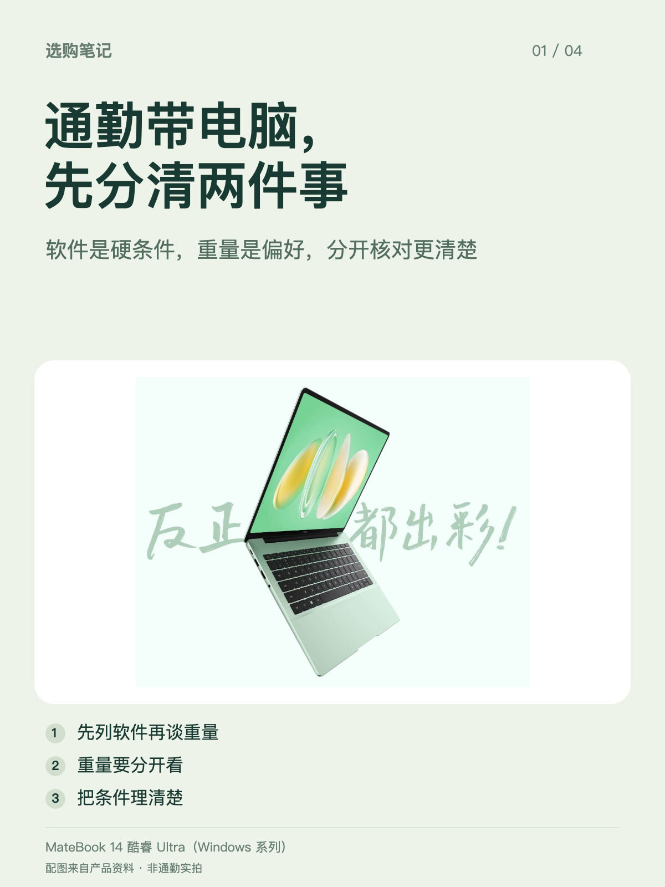
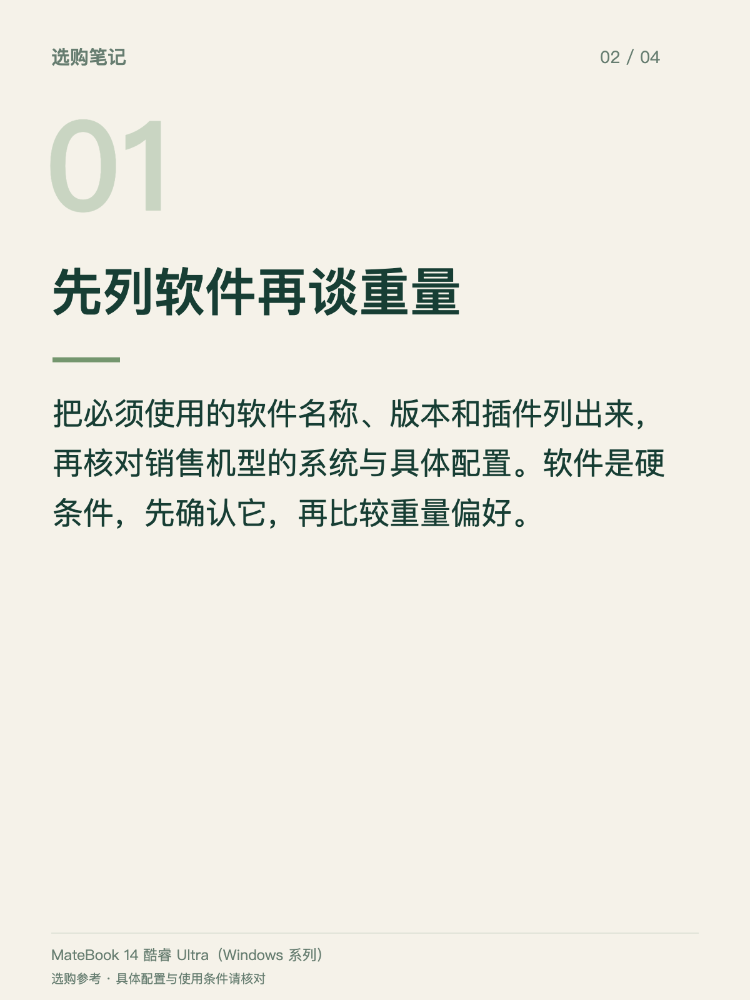
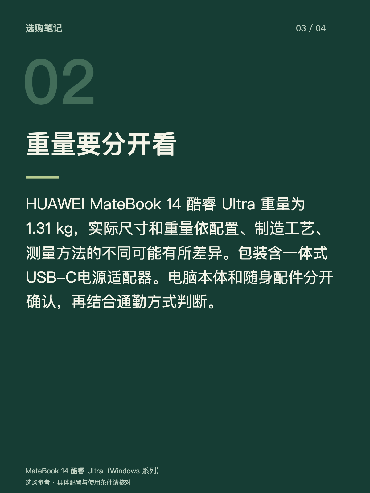
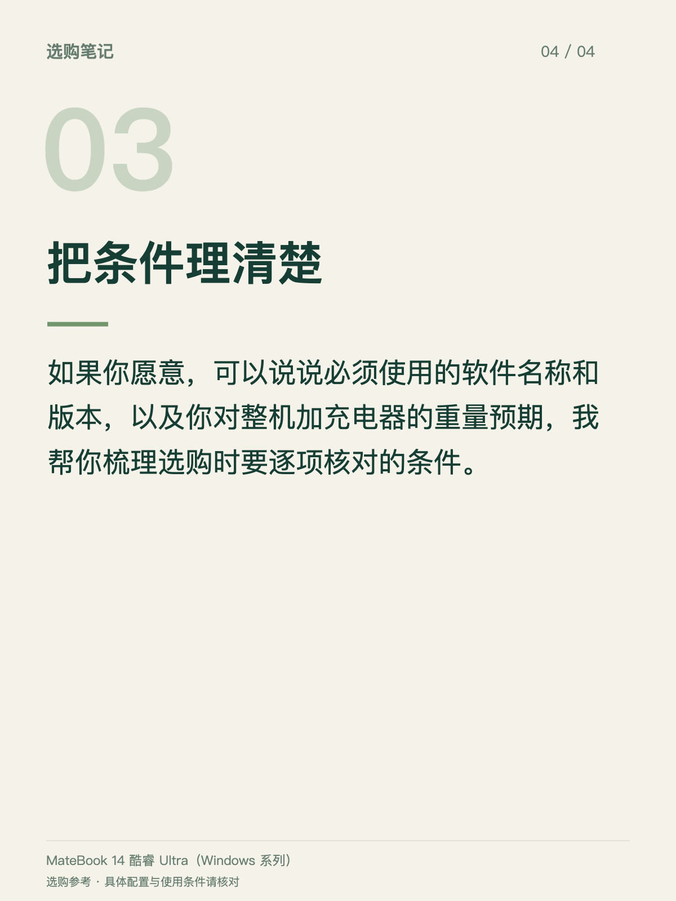

# 通勤场景图文样例

这是一套通过真实模型调用生成并经过事实核验的演示草稿，供队友对照效果。演示客户输入是虚构场景，不代表真实顾客记录。

客户困扰：每天背电脑坐地铁，还要带充电器；主要写文档、开视频会议，希望轻一点，但不确定常用软件是否适配。

演示选择：MateBook 14 酷睿 Ultra（Windows 系列）。产品图来自随项目提供的知识库，不是实际通勤拍摄照片。发布前仍需确认具体配置、软件和门店实际服务。

- [完整正文](发布正文.txt)
- [咨询回复](咨询回复-供店员参考.txt)
- [离线图文预览](通勤图文预览.html)：下载完整包后，在浏览器打开这个文件。
- [工作台截图](工作台效果.png)

